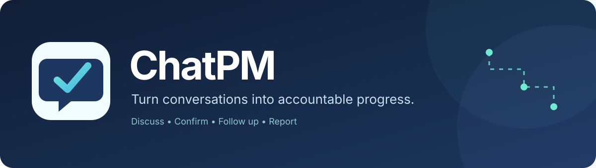

# ChatPM — 开源 AI 项目经理

<p align="center">
  
</p>


[](https://github.com/hamburger-os/ChatPM/actions/workflows/app-quality.yml)
[](https://github.com/hamburger-os/ChatPM/actions/workflows/docs-quality.yml)
[](LICENSE)

> 让项目聊天室里的承诺不再被遗忘。AI 提取有证据的候选事项、协助确认责任人与期限、跟进正式任务并生成待审核的项目报告。

**状态：实验性可运行原型；尚未完成生产级安全、性能与隐私验收。** [Apache-2.0](LICENSE) · [中文文档](docs/README.md) · [English](docs/community/overview.md#english)

## 为什么选择 ChatPM？

讨论发生在聊天室，但项目状态不应该只依赖记忆。ChatPM 将聊天中的事实与**待确认候选**分开，记录来源，由项目负责人确认后进入正式任务，再按明确规则催办和汇报。它不会把模型生成的内容直接当作已批准的计划。

> [!IMPORTANT]
> ChatPM 当前仍是**实验性可运行原型**，并非已验收的生产级服务。README 以下仅介绍已实现的能力。

## 已实现的能力

- 注册与登录、团队及项目、成员协作、消息持久化与增量拉取。
- 项目负责人显式启用外部 AI 后异步提取候选任务和风险；默认不向模型发送聊天内容。
- AI 建议保留消息依据；负责人审批正式任务、风险和澄清后的负责人/期限；任务版本冲突有保护。
- 后台按工作时间跟进已有负责人及期限的任务，并通过持久 Outbox 管理失败重试和隔离。
- 周/月项目当前状态报告草稿，负责人审核发布。**当前不是历史周期变化分析。**

**尚未实现：** 本地模型与多提供商的真实兼容性验收、文档知识库、通用语义相似度检索、完整风险升级、实时推送、完整企业身份管理和正式 SaaS 运营。以上属于 [路线图](docs/design/roadmap-acceptance.md)，不是现有功能。

## 最简安装：Docker 一条命令

已安装并启动 Docker Engine/Compose、Node.js 后，在仓库根目录运行：

```bash
npm run deploy:docker
```

命令会在首次运行时创建 `.env`，自动生成独立随机 `POSTGRES_PASSWORD` 与 `SESSION_SECRET`（不覆盖既有非占位配置），并构建、迁移和后台启动全部服务。访问 **http://localhost:3000**。再次执行不会重新生成秘密。使用 `docker compose --env-file .env -f infra/compose.prod.yml ps` 查看状态，`docker compose --env-file .env -f infra/compose.prod.yml down` 停止；不要使用 `down -v`，它会删除数据库卷。

开机自启依赖宿主机 **Docker 引擎也随系统启动**；Compose 的服务已经设置 `restart: unless-stopped`。Windows Docker Desktop 通常需要在登录时启动。默认只允许本机访问；公网部署仍需 HTTPS、备份及安全验收。

## 在本机直接部署（无需 Docker）

**Windows 11 和 Linux 都可以原生部署。** ChatPM 由 Web、API、Worker 三个 Node.js 进程和一个 PostgreSQL 数据库组成。下面是**本机安装 PostgreSQL + 运行正式构建产物**的步骤；不需要 Docker、WSL 或容器引擎。

### 1. 准备 Node.js 和 PostgreSQL

- 安装 **Node.js 24 LTS**、**PostgreSQL 17**（包括 `psql` 客户端）和 Git。
- 下载源码：`git clone https://github.com/hamburger-os/ChatPM.git`，然后进入 `ChatPM` 目录。
- 打开 PostgreSQL 的 `psql`：Windows 可使用随 PostgreSQL 安装的 SQL Shell (psql)，Linux 可执行 `sudo -u postgres psql`。创建专用角色和数据库：

```sql
CREATE ROLE chatpm LOGIN PASSWORD '请替换为自己生成的数据库强密码';
CREATE DATABASE chatpm OWNER chatpm;
```

此处密码只是标记，不可直接用于真实部署。数据库已存在时不要重复创建；若 PostgreSQL 不在本机，请改用目标数据库的主机、端口和账号。

### 2. 配置运行环境

在仓库根目录复制环境变量模板：

| Windows 11 · PowerShell | Linux · Bash |
|---|---|
| `Copy-Item .env.example .env` | `cp .env.example .env` |

生成随机会话密钥（两种系统均可）：

```bash
node -e "console.log(require('node:crypto').randomBytes(32).toString('hex'))"
```

打开根目录的 `.env`，至少修改以下配置：

```dotenv
NODE_ENV=production
DATABASE_URL=postgres://chatpm:<数据库密码的URL编码值>@127.0.0.1:5432/chatpm
SESSION_SECRET=<粘贴上面生成的随机密钥>
WEB_ORIGIN=http://localhost:3000
API_HOST=127.0.0.1
API_PORT=3001
API_INTERNAL_URL=http://127.0.0.1:3001
```

数据库密码包含 `@`、`#`、`:` 等特殊字符时，须将密码部分按 URL 编码。上面的尖括号内容必须替换为实际值；本机 HTTP 仅用于可信的本地访问，不是公网生产配置。第三方 AI 默认关闭，可暂时不填 `LLM_API_KEY`。

### 3. 安装、构建并初始化

在仓库根目录运行（Windows PowerShell / Linux Bash 命令相同）：

```bash
npm run setup:local
```

### 4. 一个终端启动

```bash
npm start
```

此命令统一启动 API、Worker、Web 三个独立进程，在同一终端输出日志；任一进程异常退出时停止整组，防止产生不完整的服务。打开 **http://localhost:3000**，使用 **http://127.0.0.1:3001/health** 检查 API。关闭终端会结束服务，这适用于本地演示，不是开机自启模式。

**开机自启**：Linux 使用仓库自带的三个 systemd 单元执行 `sudo systemctl enable --now chatpm-api chatpm-worker chatpm-web`；Windows 11 需将安装目录放在用户个人目录之外（例如 `C:\\ChatPM`），系统级安装 Node.js，准备并验证 WinSW 后，以管理员权限运行 `./infra/windows/install-services.ps1 -WinSWPath <路径> -StartNow`，默认注册为 Automatic 服务。Windows 服务安装器使用内置低权限 LocalService 并设置运行目录和密钥文件 ACL。运行前仍须由管理员验证目录继承权限、数据库连接、服务启停和重启。两种平台均需要 PostgreSQL 服务先行可用。

使用 `npm run stop` 可从另一终端安全停止 `npm start` 或 `npm run dev` 启动的原生前台服务（不会结束其他 Node.js 进程、数据库或 Docker）。开发调试只需一个终端执行 `npm run dev`（需先 `npm ci`、配置数据库并迁移）。

更详细的原生安装、服务托管、备份与恢复方法：[中文指南](docs/community/development.md#中文) · [English guide](docs/community/development.md#english) · [部署设计](docs/design/deployment.md)。

## Docker（可选）

Docker 不是必需组件。`npm run start:web` 默认只监听回环地址，容器环境通过 `start:web:container` 明确监听容器网卡。上述 `npm run deploy:docker` 提供第一次安装时的配置与秘密初始化；已有安全配置的环境也可直接执行 `docker compose --env-file .env -f infra/compose.prod.yml up -d --build`。开发用 `infra/compose.yml` 只启动 PostgreSQL。

## 运维诊断、备份与升级

原生部署可执行 `npm run doctor` 检查 API、数据库、Worker 心跳和积压事件；Docker 可执行 `docker compose --env-file .env -f infra/compose.prod.yml exec -T api node tools/ops/doctor.mjs`。检测异常时返回非零退出码，可由外部监控系统采集。启动后的首个 Worker tick 及迁移完成前不应直接判定为健康。

- 原生：`npm run backup -- --dir=./backups --keep=14`
- Docker：`npm run backup:docker -- --dir=./backups --keep=14`
- Linux：安装 `infra/linux/chatpm-backup.{service,timer}`、`chatpm-doctor.{service,timer}`，启用对应 timer 后获得定期执行。
- Windows：管理员在完成服务账户 ACL 验收后运行 `infra/windows/install-backup-task.ps1`，注册定时备份任务。

备份只保留本工具生成的最近 N 个本地文件；**本地保留不等于备份安全**，必须将备份复制到加密的离机位置并定期在隔离数据库进行恢复演练。原生升级可在确认全部进程已停止后执行 `npm run upgrade:native -- --confirm-services-stopped`（先备份再构建迁移），随后启动服务、运行 `doctor`；数据库迁移不承诺自动回滚。操作细节见 [开发与部署指南](docs/community/development.md#中文)。

## 预构建跨平台分发包（实验性）

GitHub Actions 的 `Cross-platform native builds` 工作流会为 Windows 和 Linux 生成包含 `dist/`、Next.js 构建结果、SQL、配置模板与运维工具的实验性 Artifact，不携带数据库或私有密钥。取出与目标系统匹配的 Artifact 后，仍需 Node.js/npm 和 PostgreSQL；执行 `npm ci --omit=dev`、配置本机 `.env`、`npm run db:migrate:prod`，然后 `npm start` 或安装系统服务。它不是经过签名验证的 Windows MSI/Linux DEB/RPM 安装包，也不意味着已完成开机或恢复验收。

## 选择模型提供商

默认不配置模型密钥，也不发送项目消息。部署管理员在根目录 `.env` 设置 `LLM_API_KEY`、`LLM_BASE_URL`、`LLM_MODEL` 和 `LLM_API_STYLE`（旧 `OPENAI_API_KEY`/`OPENAI_MODEL` 不再读取）。默认是 OpenAI Responses（`https://api.openai.com/v1`）；DeepSeek 示例：`https://api.deepseek.com`、`responses`、`deepseek-flash`。具备 JSON Object 支持的兼容服务可改用 `chat-completions`，但真实模型能力仍需联调；本地模型需自行部署和保护。改配置后重启 Worker 或重新执行 Docker 部署，并由项目负责人显式启用 AI。详细步骤：[中英双语部署指南](docs/community/development.md)。

## 本地演示路线

1. 注册账号并创建团队/项目，按邮箱直接添加已注册成员（当前没有邮件邀请和接受流程）。
2. 在项目聊天室中讨论可交付事项；未配置模型时可以手动创建任务。
3. 可选择配置服务端 API Key 并由项目负责人显式开启外部 AI，将讨论转为有依据的**候选任务/风险**。
4. 由负责人审批候选、确认任务负责人和期限，配置工作时间与提醒冷却。
5. 在「报告」中生成并审核当前项目状态的周/月报草稿。

此演示需要真实的本地运行环境；尚无公开在线 Demo；仓库提供完整 Compose 的本机构建方案，但尚未发布经过生产验收的正式镜像。

## 验证

```bash
npm run typecheck
npm test
npm run db:migrate
node --import tsx packages/core/test/outbox.integration.ts
node --import tsx packages/core/test/ai.integration.ts
node --import tsx packages/core/test/reports.integration.ts
node tools/test/smoke.mjs
npm run build
npm run check:distribution
npm run check:docs
```

集成测试需要可用的 PostgreSQL；CI 会自动执行。

## 安全与隐私

默认不开启第三方模型传输；Docker 部署通过 `AI_DAILY_REQUEST_LIMIT`（默认 50）配置每项目 UTC 日模型请求次数，这不是 token 费用预算；成员身份、项目权限与候选审批由服务端控制。请阅读 [安全政策](SECURITY.md)、[隐私与数据边界](PRIVACY.md) 和 [当前限制](docs/design/implementation-status.md)。敏感业务数据请勿直接用于未经生产验收的实例。

## 参与开源

- [参与贡献](CONTRIBUTING.md) · [社区行为准则](CODE_OF_CONDUCT.md) · [漏洞报告](SECURITY.md) · [支持渠道](SUPPORT.md)
- [治理与维护](GOVERNANCE.md) · [架构和设计](docs/design/README.md) · [当前能力与限制](docs/design/implementation-status.md)
- [维护与状态检查设置](docs/community/maintainers.md#中文) · [Issues](https://github.com/hamburger-os/ChatPM/issues) · [Discussions（启用后）](https://github.com/hamburger-os/ChatPM/discussions)

**English:** ChatPM is an experimental, chat-centered AI project management tool. It keeps evidence-linked proposals separate from approved project facts. Cloud and self-hosted deployment with cloud/local model options are product goals; they are not all shipped today. See the [English guide](docs/community/development.md#english).

## 本地测试反馈：模型与对话操作

登录并创建项目后，打开「AI 模型」设置服务商、模型、Key、输入字符预算与最大输出 Token，点击「保存模型配置」和「测试连接」。再到「设置」启用「AI 助手」。输入 `@AI 请概览当前项目` 可触发只读回复。AI 自动候选与后续澄清仍需项目负责人审批，AI 处理记录可查看模型执行状态；规则式到期任务提醒在「设置」独立开启，不需要 AI 模型。内置 DeepSeek/OpenAI 使用固定 URL；自定义模型 URL 只能由部署管理员在服务器 .env 中配置。更多详情见 [开发部署指南](docs/community/development.md)。

## 项目进度闭环升级（ADR-022）

- **正式任务**：只填写到期日期，不需要小时或上午/下午；旧截止时间由迁移脚本按项目时区映射为日期。
- **AI 关联已有任务**：正常聊天中的阶段进展、阻塞与完成声明优先关联正式任务，以证据建议待项目负责人审阅；新增任务/风险仍走候选审批，不会自动批准。
- **主动催办**：正式任务登记后安排阶段性检查，提前于截止日收集进度；临期与阻塞增加关注，同时遵循提醒时间及冷却。
- **模型能力**：DeepSeek 兼容推理等级的协议映射，扩大可配置上下文字符与输出 Token 预算；大模型能力不代表每次默认输入其完整 1M Token 窗口。
更多部署/测试与限制见 [开发指南](docs/community/development.md)。
